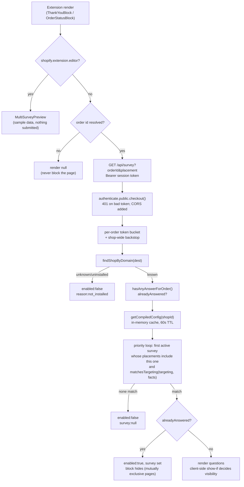
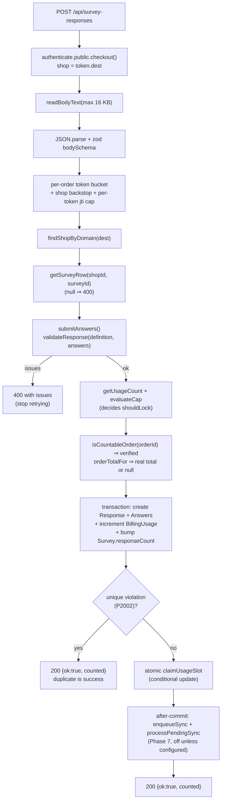
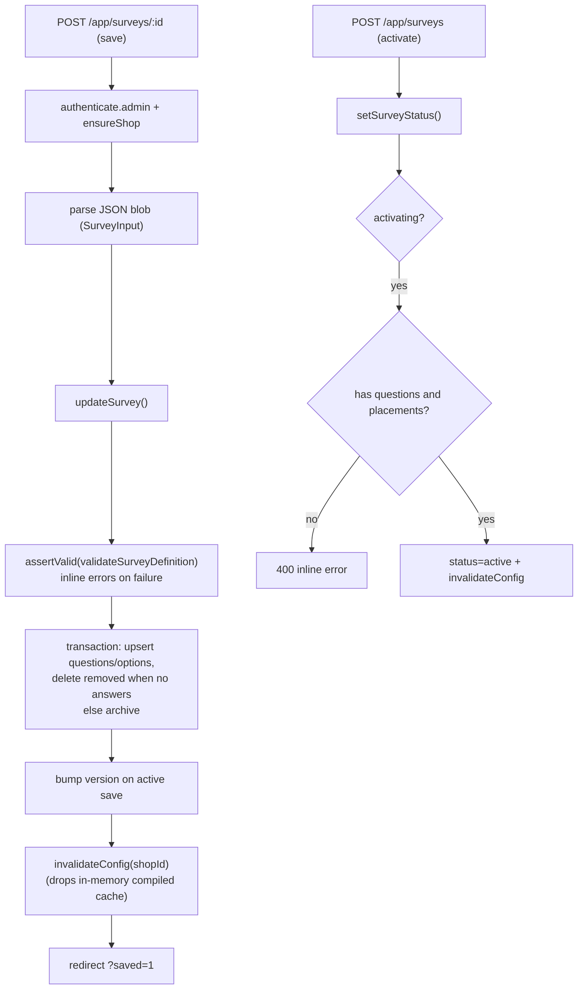
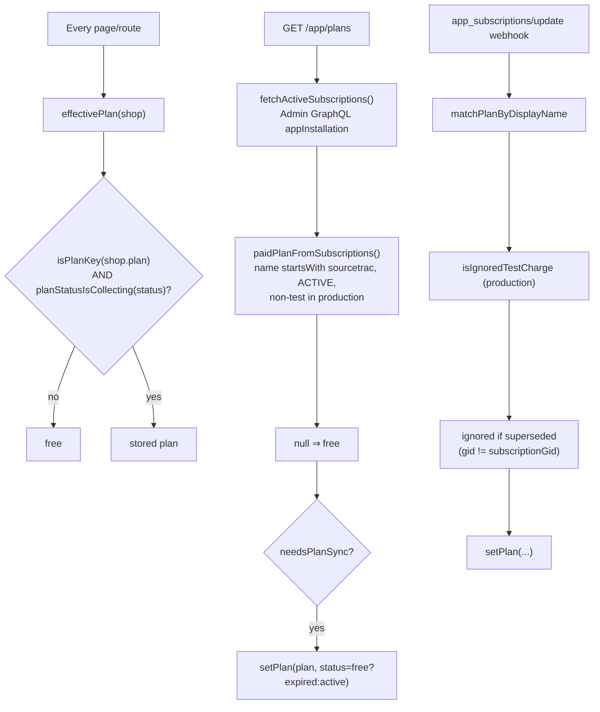
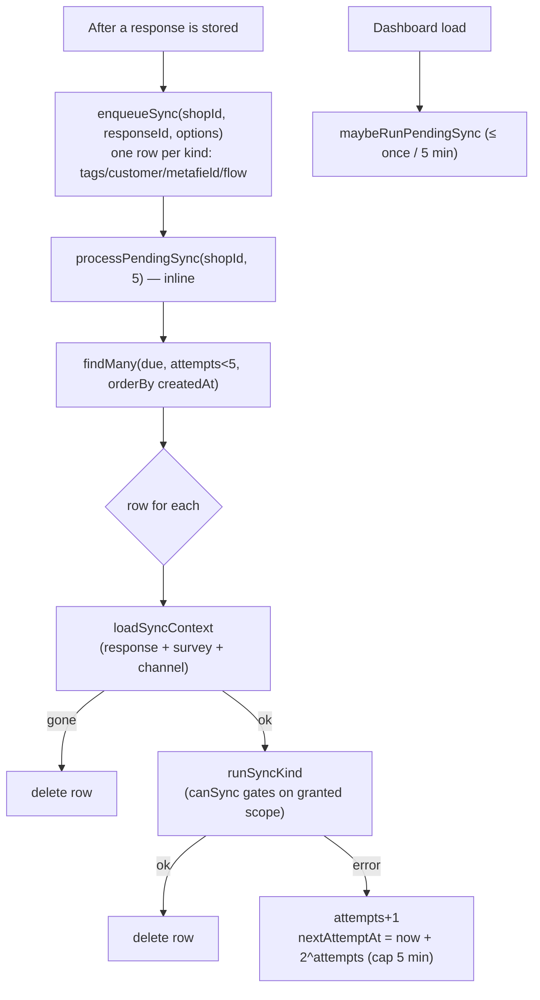
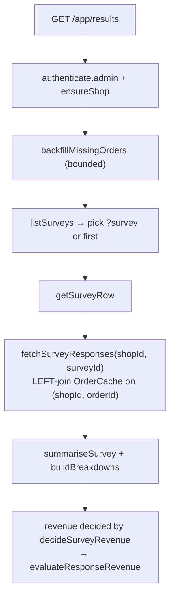
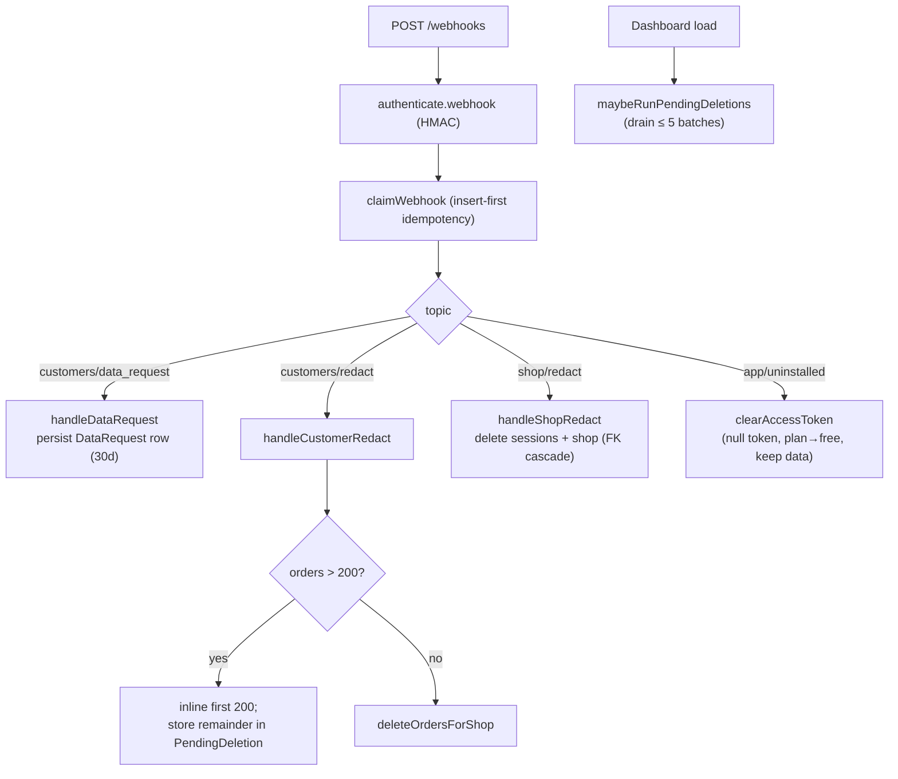
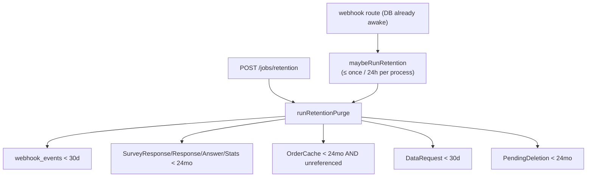
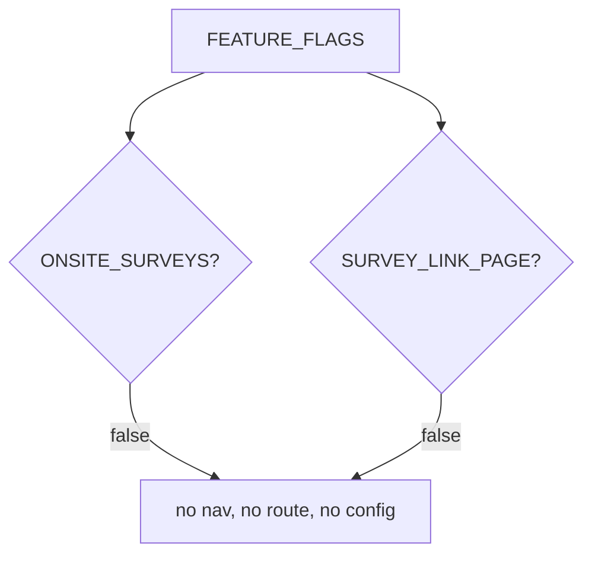
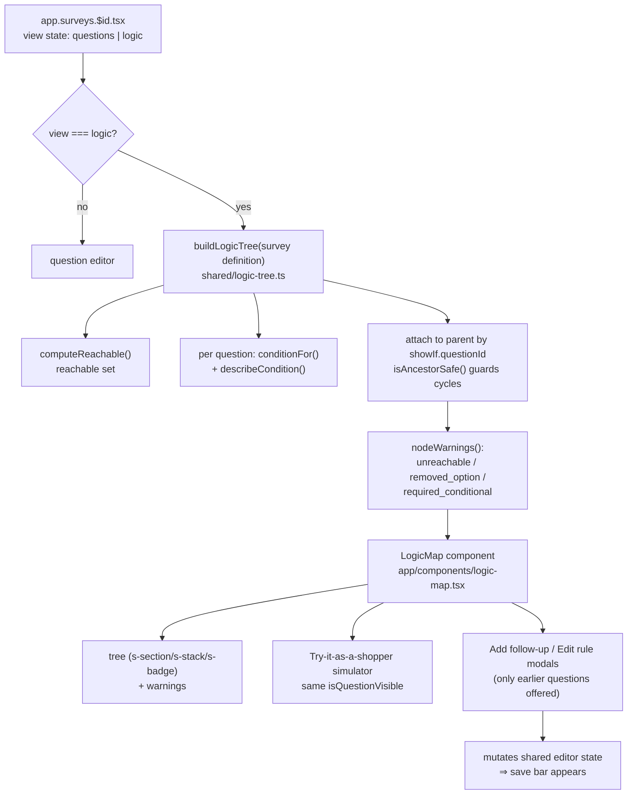

# Logic map — SourceTrac

Developer-facing map of every decision point, with the file and function that
implements it. Built during the logic/security/completeness audit (Phase A) and
kept in step with the code.

Legend for the difference markers that remain:

- **⚠ differs** — the code does something different from the upgrade plan. Every
  marker below is explained inline. (No unmarked divergences are known.)

---

## 1. Show or hide a survey (checkout / order-status)

| Decision | File / function |
|---|---|
| Editor preview | `extensions/sourcetrac-*/src/*Block.tsx` (`shopify.extension.editor`) |
| Route + auth + CORS | `app/routes/api.survey.tsx` → `loader` |
| Rate limiting | `app/lib/rate-limit.server.ts` → `consumeToken`, `consumeShopBackstop` |
| Shop lookup | `app/lib/shop.server.ts` → `findShopByDomain` |
| Already answered | `app/lib/answers.server.ts` → `hasAnyAnswerForOrder` |
| Compiled config + cache | `app/lib/surveys.server.ts` → `getCompiledConfig`, `buildConfig` |
| Priority + targeting | `app/routes/api.survey.tsx` (`config.surveys.find`) + `shared/survey-config.ts` → `matchesTargeting` |
| Client-side show-if | `extensions/shared/src/use-multi-survey.ts` → `questionVisible` (mirrors `isQuestionVisible`) |

Status, placement, dates, first/returning, order value + currency, country,
language, sample are all evaluated inside `matchesTargeting`.

- **⚠ differs** — plan Phase 4 preferred delivery of the compiled config through
  an app-owned shop **metafield** read directly by the extension. That metafield
  declaration syntax could not be verified offline, so the plan's explicit
  fallback (**in-memory cache + `GET /api/survey`**) shipped. Recorded in
  `FUTURE_TASKS.md`. No behavioural difference for the buyer.
- **⚠ differs** — the plan's `plan_unsupported` config gate was deliberately not
  implemented. Shopify only runs the block on plans that support it, so our own
  plan reading could only ever hide the survey wrongly. `checkoutSupported`
  drives an admin banner only. Documented in `api.survey-config.tsx`.

---

## 2. Submit a response

| Decision | File / function |
|---|---|
| Auth, size cap, body schema | `app/routes/api.survey-responses.tsx` |
| Rate limits + per-token cap | `app/lib/rate-limit.server.ts` (`consumeTokenSubmission`) |
| Validation | `shared/survey-rules.ts` → `validateResponse` |
| Verification snapshot | `app/lib/answers.server.ts` → `isCountableOrder`, `orderTotalFor` |
| Cap + write | `app/lib/answers.server.ts` → `submitAnswers`, `claimUsageSlot` |
| Duplicate rule | `submitAnswers` (`isUniqueViolation`) |
| Sync (Phase 7) | `app/lib/sync.server.ts` → `enqueueSync`, `processPendingSync` |

- **✅ implemented (was ⚠ differs)** — the `Response.verified` /
  `unverifiedFailed` columns ship (migration
  `20261012140000_response_verification`). A known, countable order is
  `verified = true`; `upsertOrderCache` reconciles a late order and stores the
  real total; `markUnverifiedFailedResponses` flips the rest after 24 h; revenue
  counts verified orders only and `unverifiedFailed` rows are excluded. Historic
  rows read `verified = NULL` and keep the legacy "total present decides"
  behaviour.
- **✅ implemented (was ⚠ differs)** — the per-token `jti` submission limiter
  (`MAX_SUBMISSIONS_PER_TOKEN = 2`) is in place, checked before any DB read.

---

## 3. Save or activate a survey (admin)

| Decision | File / function |
|---|---|
| Route | `app/routes/app.surveys.$id.tsx`, `app/routes/app.surveys._index.tsx` |
| Validation | `shared/survey-rules.ts` → `validateSurveyDefinition`, wrapped by `app/lib/surveys.server.ts` → `assertValid` |
| Persistence + archiving | `app/lib/surveys.server.ts` → `persistQuestions`, `updateSurvey`, `setSurveyStatus` |
| Cache invalidation | `app/lib/surveys.server.ts` → `invalidateConfig` |

- **⚠ differs** — plan Phase 4 wanted a compiled-config **size check that blocks
  the save**. `getCompiledConfig` only **logs** `compiled_config_too_large`; the
  save is never blocked. Sizes are far below the limit in practice (16 KB). Left
  as a soft warning on purpose so a merchant is never locked out of saving.
- **⚠ differs** — plan Phase 4 wanted a metafield write on save. Not done (same
  reason as flow 1).

---

## 4. Plan check

| Decision | File / function |
|---|---|
| Effective plan | `app/lib/plans.ts` → `effectivePlan`, `planStatusIsCollecting` |
| Cap | `app/lib/plans.ts` → `evaluateCap`, `currentUtcPeriod` |
| Partner-API read | `app/lib/billing.server.ts` → `fetchActiveSubscriptions`, `paidPlanFromSubscriptions` |
| Reconcile on load | `app/routes/app.plans.tsx` → `loader` |
| Webhook path | `app/lib/webhooks.server.ts` → `applySubscription`, `normaliseSubscriptionStatus` |

What each plan unlocks is in `app/lib/plans.ts` (`PLANS[].features`). Downgrade
keeps all data; extra surveys are not deleted.

- **⚠ differs** — the plan (Appendix 1) describes **Shopify App Pricing** with
  plan handles `free`/`growth`/`pro` and a Partner API `activeSubscription`
  token, and explicitly says the app must **not** call `appSubscriptionCreate`.
  The shipped app uses the **Billing API** (`appSubscriptionCreate`) with plans
  `free`/`growth`/`scale` and no Partner API token — see flow-4 table and
  `AUDIT_AND_PLAN.md` §8, which records that Billing already existed when the
  upgrade began. The table columns differ (`pro` vs `scale`), the enforcement
  points are equivalent. Full reconciliation in `COMPLIANCE_MATRIX.md`
  (Appendix-1 rows, status 🔁).

---

## 5. Pending sync retry (Phase 7)

| Decision | File / function |
|---|---|
| Triggers | `app/lib/answers.server.ts` (inline), `app/routes/app._index.tsx` (`maybeRunPendingSync`) |
| Batch + backoff + give-up | `app/lib/sync.server.ts` → `processPendingSync` (MAX_SYNC_ATTEMPTS = 5) |
| Scope gate | `app/lib/scopes.server.ts` → `canSync` |
| Example worker | `tests/unit/sync-pending.test.ts` |

Status: implemented as the plan describes.

---

## 6. Results loading

| Decision | File / function |
|---|---|
| Route | `app/routes/app.results.tsx` |
| Query | `app/lib/survey-analytics.server.ts` → `fetchSurveyResponses` |
| Revenue | `app/lib/survey-analytics.server.ts` → `decideSurveyRevenue` → `app/lib/revenue.ts` |
| Stats | `summariseSurvey`, `buildBreakdowns` |

- **⚠ differs** — the plan wanted the unfiltered (daily totals) path to read
  `SurveyDailyStats`. `SurveyDailyStats` is created by the schema/migration but is
  **not read or written** by any route today; every page reads raw `Response`.
  The table is unused, not wrong. Deferred in `FUTURE_TASKS.md`.

---

## 7. Privacy flows

| Decision | File / function |
|---|---|
| Route + idempotency | `app/routes/webhooks.tsx`, `app/lib/webhooks.server.ts` → `claimWebhook` |
| Handlers | `app/lib/compliance.server.ts` → `handleDataRequest`, `handleCustomerRedact`, `handleShopRedact` |
| Lazy drain | `app/lib/compliance.server.ts` → `processPendingDeletions`, `maybeRunPendingDeletions` |
| Uninstall | `app/lib/shop.server.ts` → `clearAccessToken` |

Status: implemented. Idempotency is layered on the ledger and each handler is
safe to run twice.

---

## 8. Data retention cleanup

| Decision | File / function |
|---|---|
| Schedule | `app/routes/webhooks.tsx` (`void maybeRunRetention()`), `app/routes/jobs.retention.ts` |
| Purge | `app/lib/retention.server.ts` → `runRetentionPurge` |
| Totals stay correct | orders kept while any response still references them |

Status: implemented. Note the tenant-scoping caveat in `AUDIT_REPORT.md` F-007
(cleanup is global, not per-shop, though every window is uniform).

---

## 9. Bonus features (flags off)

| Decision | File / function |
|---|---|
| Flags | `shared/feature-flags.ts` → `FEATURE_FLAGS` |
| Read by | `app/routes/app.settings.tsx` (status only) |

Both are **off**; the `onsite` and `link` placements exist in the type union but
no route renders them. Nothing in `app/` branches on the flags beyond Settings.

---

## 10. Logic map builder (admin, Phase G)

| Decision | File / function |
|---|---|
| Builder (pure) | `shared/logic-tree.ts` → `buildLogicTree` |
| Reachability | `computeReachable` |
| Condition labels | `conditionFor`, `describeCondition`, `resolveOptionLabel` |
| Warnings | `nodeWarnings`, `allowedOptionIds` |
| Reachability guard | `isAncestorSafe` |
| UI | `app/components/logic-map.tsx` |
| Editor wiring | `app/routes/app.surveys.$id.tsx` (`view` state, anchors) |
| Simulator visibility | `@shared/survey-rules` → `isQuestionVisible` |

No ⚠ differs markers: the map is additive and does not touch the checkout
extension bundle.

